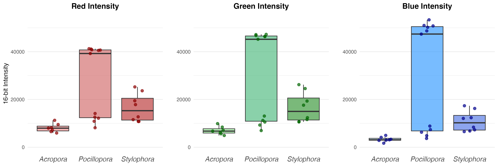
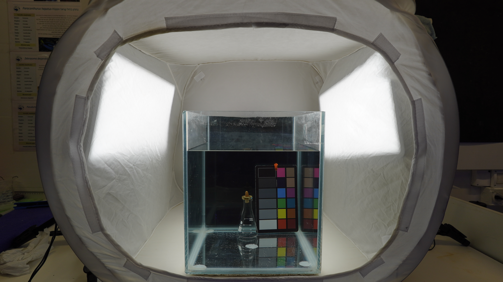
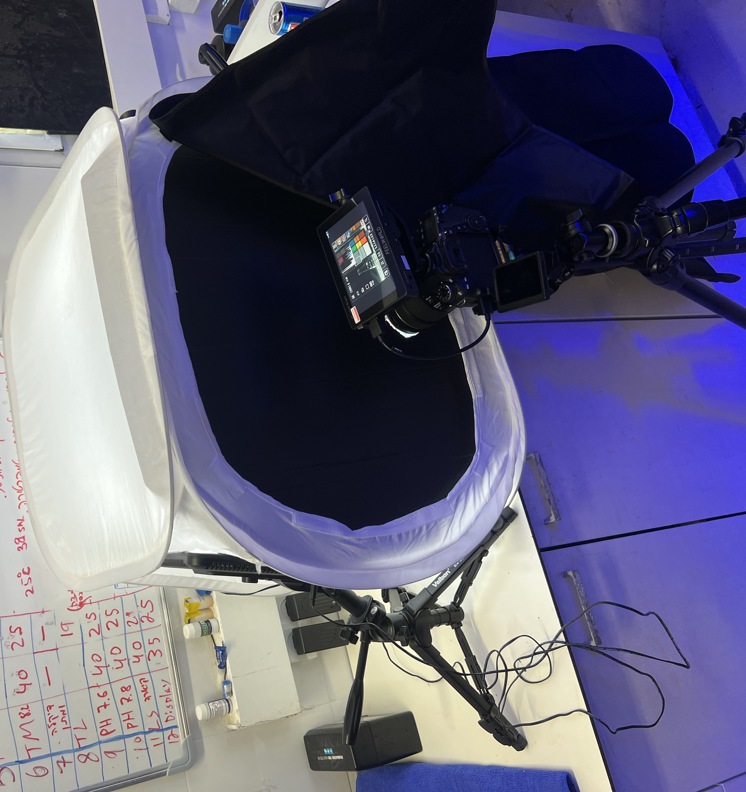
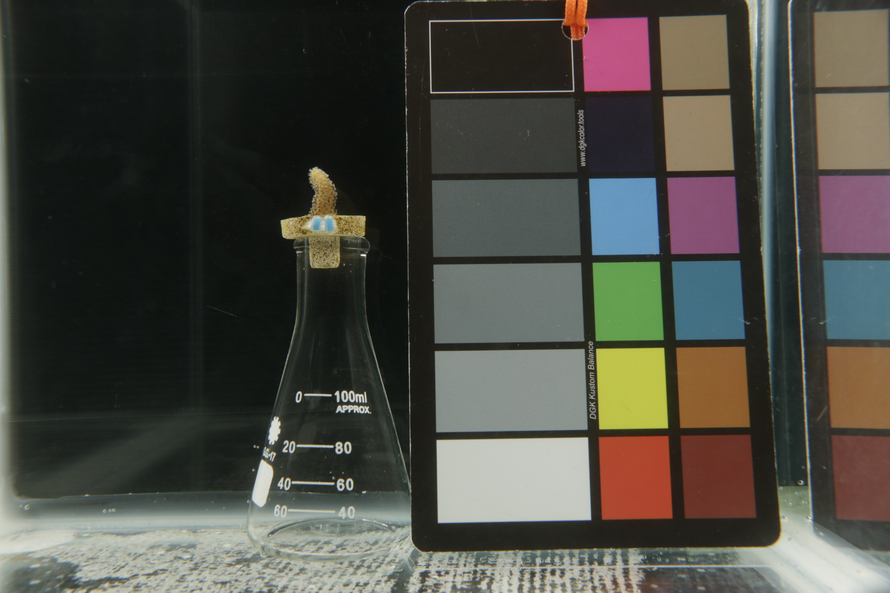
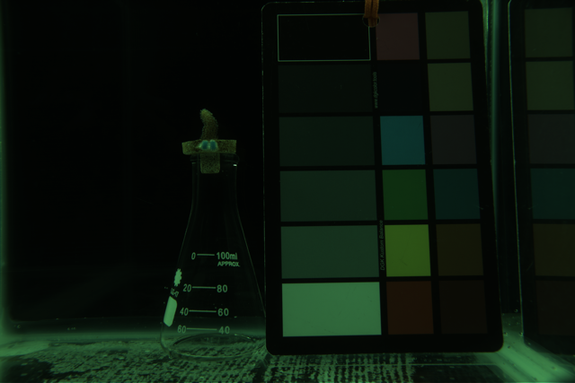
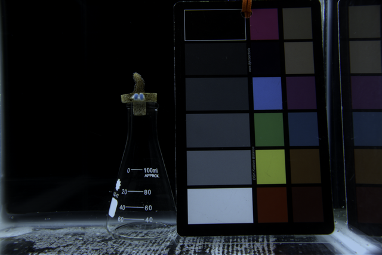
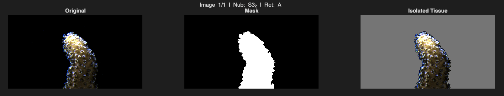
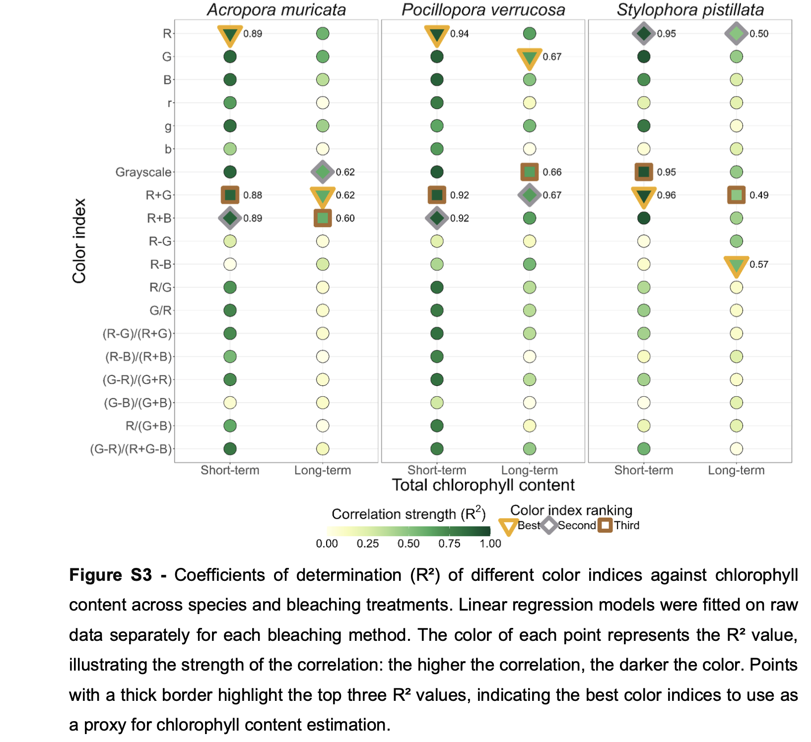

* Boaz Abramson - University of Haifa - Mass Lab & Color Lab
* **Supervisors:** Prof. Tali Mass & Prof. Derya Akkaynak
* **Date:** 1/9/26

### Current Status
Out of 89 experimental coral nubs, 25 have been fully processed for Chl-a density (µg/cm²) and RGB values (8 *Stylophora* nubs, 10 *Pocillopora*, and 7 *Acropora*). 10 nubs have been imaged and frozen, but have not been processed for Chl-a. Over the past three weeks, the tank temperature has been elevated from 24°C to 30°C. Tank temperature will continue to rise over the next month, and as nubs show signs of bleaching, they will be imaged, frozen, and processed to complete the RGB/Chl-a index reference data. Currently, the *Acropora* data lacks medium bleached & severely bleached data points, the *Pocillopora* data lacks medium bleached data points, and the *Stylophora* lacks severely bleached data points (Fig. 1).

 

*Figure 1: 16-bit RGB intensity distributions for the Acropora, Pocillopora, and Stylophora nubs. Higher pixel intensities indicate a brighter color (more bleached).*

---

### Preliminary Results
* Following RGB and Chl-a extraction for each coral nub, the values were tested for correlation strength across 22 index options (19 based on RGB, 3 from RGB converted to CIELAB) and visualized using a modified R script from Ferrara et al., 2026 (Fig. 2).
* Notably, the R² values presented here (Fig. 2) for *Pocillopora* (R² = 0.91, p < 0.001) and *Stylophora* (R² = 0.89, p < 0.001) are stronger than the values obtained for the long-term heat stress bleaching experiment conducted by Ferrara et al., 2026, which follows a similar experimental protocol but used non-linear .png images for RGB extraction (Fig. S7).

 

*Figure 2: Correlation strength (R²) between chlorophyll-a density and 22 color indices (19 RGB-derived & 3 converted to CIELAB). Thick borders indicate the top three indices. Darker green indicates a stronger correlation. Further details regarding specific indices can be found in Supplementary Table 1. Visualization performed with modified R code from Ferrara et al., 2026.*

---

### Discussion/Questions
* The preliminary results presented here are promising and in some cases outcompete similar published experiments. Collecting the data from the remaining coral nubs will likely increase the strength of the correlations, especially with the *Acropora*.
* While Chl-a here was calculated using the wavelengths 630, 663, and 750 nm, some studies also utilize the wavelength 647 to remove overlap between Chl-a and Chl-C₂. The 647 wavelength was unfortunately not collected for all samples. If necessary, the remaining coral tissue in the freezer can be used to re-run the samples that lack the 647 wavelength data. Is this a worthwhile endeavor, or is the simple version of the Jeffrey & Humphrey 1975 equation with the 630, 663, and 750 nm wavelengths sufficient?
* When the coral nubs extend their polyps, the light shining on them leads to a "glint" on the rounded edges of the polyps (Fig. S6). Currently, these "glints" have been included in the averaged RGB data across the collected samples. Is it worthwhile to remove these "glints" from the index data, and if so, is there an efficient way to remove these glints?

---

### Methods
* **Chlorophyll-a extraction:** Concentration was extracted and calculated according to Jeffrey & Humphrey, 1975 for dinoflagellates, 100% acetone, with a path length of 0.588:
  (1 cm cuvette) Chlorophyll a = [11.43(A663 - A750) / 0.588] - [0.64(A630 - A750) / 0.588]
* **Surface Area:** Surface Area was determined using the foil mask method for each coral nub skeleton. Squares of foil with a variety of surface areas were weighed to obtain a linear regression equation. A foil mask was crafted over the living tissue surface area of each coral skeleton and weighed to obtain surface area via the linear regression equation.
* **Imaging:** An imaging rig was designed to provide uniform, consistent lighting and minimize shadows. An aquarium with a black background was placed in the center of a Godox light box and filled with water from the coral nubs' tank (Fig. S1). A waterproof DGK Kustom Balance color chart and an Erlenmeyer flask (coral nub pedestal) were placed near the back of the aquarium. Godox LEDP260C lights were placed on the left and right sides of the light box and set to 100% power at 5600K. A black panel with a hole for the camera lens was added to reduce reflections on the aquarium glass (Fig. S2). Using a Canon EOS 70D camera and a Canon EFS 18-135mm lens with a Kenko Real Pro lens protector 67sn on a tripod, full size RAW images were taken of experimental coral nubs at 18mm with shutter speed 1/25, F/9.0 aperture, and ISO 320 (note that medium size RAW images are not true RAW images). Room lights were turned off, windows were covered, and a black sheet was placed over the camera to further reduce any ambient light. To cover all sides of each coral nub, each nub was imaged four times with a 90 degree rotation between each image.
* **Image processing:** Following RAW image collection, each image file was given a prefix label according to the nub ID and image rotation number (E.G. A2_3B_MG_8948.CR2 is Acropora colony 2, nub 3, second image/rotation). Using Adobe DNG converter, RAW images were converted to DNG files according to instructions obtained in the Underwater Colorimetry (UWC) course (DNG 1.6 backward version, linear (demosaiced), uncompressed, no lossy compression, no embedded original RAW file). The DNG files were then converted to linear .tif files using the dng2tiff code provided in the UWC course (Fig. S4). Modified demo code from Akkaynak et al., 2014 was used to white balance and color transform the tif images for final RGB extraction (Fig. S5).
* **RGB Extraction:** Color transformed 16-bit images of coral nubs were masked to only include pixels of coral nub tissue (Fig. S6). RGB values were extracted and averaged across all four image rotations for each nub.

---

### Supplemental Information
All of the RAW, .tif, and color transformed images can be accessed via this drive:  [RGB Chl a Index Images](https://drive.google.com/drive/folders/1I4jSLraeYKuJXJmhBUNIETigcYyGOGo6?usp=drive_link)

The csv files, R scripts, and MATLAB scripts relevant to this report can be found here: [RGB Chl-a Progress Report Repository](https://github.com/Scuba-Bo/RGB_Chl_a_Index_Progress_Report)

**Table S1: Retrieved from Ferrara et al., 2026.** List of the 19 RGB-derived color indices included in this report, including their equations and sources. The CIELAB indices are not included in this list, as that is an inclusion unique to this specific report and was not a part of the study done by Ferrara et al., 2026.

| Index | Name of color parameter | Definition | Reference |
|---|---|---|---|
| R | Red index | Red (R) channel | (Rigon et al., 2016) |
| G | Green index | Green (G) channel | (Rigon et al., 2016) |
| B | Blue index | Blue (B) channel | (Rigon et al., 2016) |
| r (normalized) | Normalized Red index | R / (R+G+B) | (Rigon et al., 2016) |
| g (normalized) | Normalized Green index | G / (R+G+B) | (Rigon et al., 2016) |
| b (normalized) | Normalized Blue index | B / (R+G+B) | (Rigon et al., 2016) |
| Grayscale | RGB weighted mean | 0.299*R + 0.587*G + 0.114*B | (Güneş et al., 2016) |
| R+G | Red-Green sum index | | (Ali et al., 2012) |
| R+B | Red-Blue sum index | | (Hu et al., 2010) |
| R-G | Red minus Green index | | (Chen et al., 2020) |
| R-B | Red minus Blue index | | (Ali et al., 2012) |
| R/G | Red-Green simple ratio | | (Sánchez-Sastre et al., 2020) |
| G/R | Green-Red simple ratio | | (Ali et al., 2012) |
| (R-G)/(R+G) | Normalized Red-Green difference | | (Kawashima, 1998) |
| (R-B)/(R+B) | Normalized Red-Blue difference | | (Ali et al., 2012) |
| (G-R)/(G+R) | Green vegetation index | | (Gitelson et al., 2002) |
| (G-B)/(G+B) | Normalized Green-Blue difference | | (Kawashima, 1998) |
| R/(G+B) | Simple ratio intensity RGB- | | (Widjaja Putra & Soni, 2018) |
| (G-R)/(R+G-B) | Visible atmospheric resistance | | (Widjaja Putra & Soni, 2018) |

 

*Figure S1: Aquarium, light box, and light orientation.*

 

*Figure S2: Full imaging rig with black panel and camera.*

 

*Figure S3: RAW image of nub S3_2A (JPG version associated with the RAW image).*

 

*Figure S4: Linearized .tif image of nub S3 2A before white balancing.*

 

*Figure S5: White-balanced + Color transformed S3 2A .tif*

 

*Figure S6: Isolating the pixels of a coral nub via threshold masking.*

 

*Figure S7: Retrieved from Ferrara et al., 2026 (Supplementary Information). Note that the preliminary results presented in this report (Fig. 2) should be compared to the long term heat stress experiment in this figure, not the short term experiment.*

---

### Citations
* Akkaynak, D., Treibitz, T., Xiao, B., Gürkan, U. A., Allen, J. J., Demirci, U., & Hanlon, R. T. (2014). Use of commercial off-the-shelf digital cameras for scientific data acquisition and scene-specific color calibration. JOSA A, 31(2), 312-321. https://doi.org/10.1364/JOSAA.31.000312
* Ferrara, E. F., Bauer, L., Puntin, G., Bautz, F., Celayir, S., Do, M.-S., Eck, F., Heider, M., Wissel, P., Arnold, A., Wilke, T., Reichert, J., & Ziegler, M. (2026). Red, green, blue color indices as proxy for Symbiodiniaceae cell density and chlorophyll content during coral bleaching. Limnology and Oceanography: Methods, 24(6), e70047. https://doi.org/10.1002/lom3.70047
* Jeffrey, S. W., & Humphrey, G. F. (1975). New spectrophotometric equations for determining chlorophylls a, b, cl and c2 in higher plants, algae and natural phytoplankton. Biochemie Und Physiologie Der Pflanzen, 167(2), 191–194. https://doi.org/10.1016/S0015-3796(17)30778-3