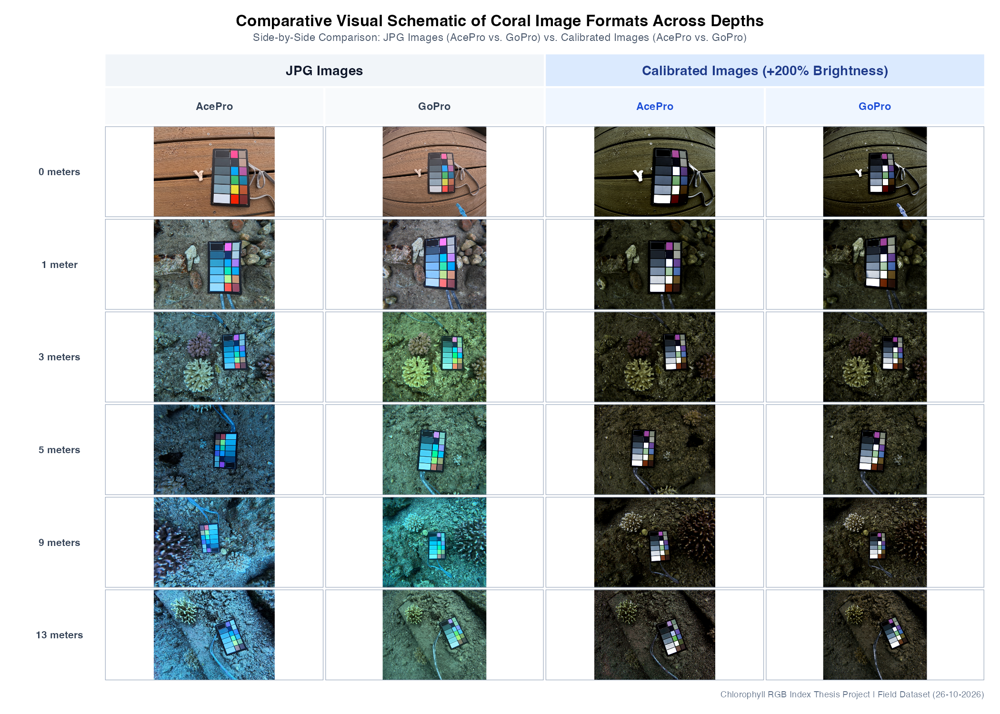

* Boaz Abramson - University of Haifa - Mass Lab & Color Lab
* **Supervisors:** Prof. Tali Mass & Prof. Derya Akkaynak
* **Date:** 28/10/26

### Summary of Findings
* Color patch consistency across an underwater depth gradient (0m to 13m) was evaluated separately for both **Insta360 AcePro** and **GoPro** camera systems, comparing uncalibrated JPGs, linear RAW/DNG files, and color-calibrated TIF images.
* Within each camera system, color calibration reduced 3D Euclidean dispersion across depth by **~84%** (AcePro dispersion dropped from **0.1947** to **0.0317**; GoPro dispersion dropped from **0.1609** to **0.0263**).
* Cross-camera comparison revealed that while uncalibrated JPGs from AcePro and GoPro differ significantly (**0.1898** 3D Euclidean distance), color calibration successfully aligns both camera sensor outputs into a unified color space, reducing inter-camera error by **90.4%** down to **0.0183**.

---

### Field Testing & Depth Gradient Setup
Field image sets were collected across six matched depth stations: **0 meters, 1 meter, 3 meters, 5 meters, 9 meters, and 13 meters**. At each depth, paired images were captured using both **Insta360 AcePro** and **GoPro** camera systems under ambient underwater lighting.

To evaluate how camera encoding and color calibration affect quantitative image data as depth increases, four image conditions were analyzed and compared:
1. **AcePro JPG (Uncalibrated)**
2. **GoPro JPG (Uncalibrated)**
3. **AcePro Calibrated (Color Transformed TIF)**
4. **GoPro Calibrated (Color Transformed TIF)**

---

### Visual Comparative Schematic Across Depths

The schematic figure below presents matched sample pairs across all six depths. Uncalibrated JPG images from both cameras are positioned side-by-side on the left, while color-calibrated images are positioned side-by-side on the right.

 

*Figure 1: Comparative visual schematic comparing uncalibrated JPG images (AcePro vs. GoPro) alongside color-calibrated images across six depth levels (0m to 13m). Calibrated images include a uniform brightness scaling boost for optimal visualization.*

---

### Quantitative Color Patch Consistency Analysis (3D Euclidean Distance)

To quantify color stability across the depth gradient, color patch values (Patch 1 = top left black, moving down vertically and to the right so that patch 18 = bottom right reddish brown)) from the waterproof DGK Kustom Balance chart were extracted from each image. For each camera and format space, global Min-Max normalization was applied across the 3D RGB space, and the mean 3D Euclidean distance (dispersion) from each patch's depth centroid was calculated.

Lower values indicate superior color consistency across varying underwater depths or between camera systems.

 

#### Table 1: Insta360 AcePro — Depth Consistency Across Formats (0m to 13m)

| Image Format Space | Mean 3D Euclidean Dispersion | Min Patch Dispersion | Max Patch Dispersion | SD Dispersion | Dispersion Reduction vs. JPG |
|---|---|---|---|---|---|
| **Uncalibrated JPG** | 0.1947 | 0.0355 | 0.2940 | 0.0599 | Baseline (0%) |
| **RAW / DNG (Linear)** | 0.0919 | 0.0189 | 0.2480 | 0.0580 | 52.8% Reduction |
| **Color-Calibrated TIF** | **0.0317** | **0.0001** | **0.0763** | **0.0193** | **83.7% Reduction** |

*Table 1: AcePro 3D Euclidean dispersion statistics across 18 color patches evaluated across six underwater depths (0m to 13m).*

 

#### Table 2: GoPro — Depth Consistency Across Formats (0m to 13m)

| Image Format Space | Mean 3D Euclidean Dispersion | Min Patch Dispersion | Max Patch Dispersion | SD Dispersion | Dispersion Reduction vs. JPG |
|---|---|---|---|---|---|
| **Uncalibrated JPG** | 0.1609 | 0.0833 | 0.2090 | 0.0358 | Baseline (0%) |
| **RAW / DNG (Linear)** | 0.0645 | 0.0153 | 0.1720 | 0.0388 | 59.9% Reduction |
| **Color-Calibrated TIF** | **0.0263** | **0.0026** | **0.0679** | **0.0150** | **83.7% Reduction** |

*Table 2: GoPro 3D Euclidean dispersion statistics across 18 color patches evaluated across six underwater depths (0m to 13m).*

 

#### Table 3: Cross-Camera Discrepancy — AcePro vs. GoPro at Matched Depths

| Comparison Condition | Mean Cross-Camera Distance | Min Depth Station Dist | Max Depth Station Dist | SD Cross-Camera Dist | Inter-Camera Error Reduction |
|---|---|---|---|---|---|
| **AcePro JPG vs. GoPro JPG** | 0.1898 | 0.0961 | 0.3020 | 0.0823 | Baseline (0%) |
| **AcePro RAW vs. GoPro RAW** | 0.1284 | 0.0942 | 0.2000 | 0.0424 | 32.3% Reduction |
| **AcePro Calibrated vs. GoPro Calibrated** | **0.0183** | **0.0073** | **0.0514** | **0.0166** | **90.4% Reduction** |

*Table 3: Cross-camera 3D Euclidean distance measuring the discrepancy between AcePro and GoPro sensor outputs at corresponding depth levels.*

---

### Key Discussion Points
* **Uncalibrated JPG Variability:** Standard camera JPGs apply non-linear gamma curves, automatic white balance, and proprietary color enhancement algorithms underwater. As depth increases and red light is selectively absorbed, JPG dispersion remains high in both AcePro (**0.1947**) and GoPro (**0.1609**).
* **Inter-Camera Discrepancy:** When comparing uncalibrated JPGs between AcePro and GoPro at identical depths, the cross-camera discrepancy is **0.1898**, reflecting significant differences in proprietary color pipelines between camera manufacturers.
* **Linear RAW Advantage:** Removing non-linear camera processing curves via linear DNG/RAW demosaicing cuts intra-camera depth dispersion by over **50%** in both systems.
* **Color Calibration Convergence:** Full color calibration matrix transformations reduce intra-camera depth dispersion to **0.0317** (AcePro) and **0.0263** (GoPro). Crucially, calibration aligns the outputs of both cameras, reducing inter-camera error to **0.0183** (**90.4% reduction**), proving that color-calibrated workflows render cross-camera research datasets directly comparable.
