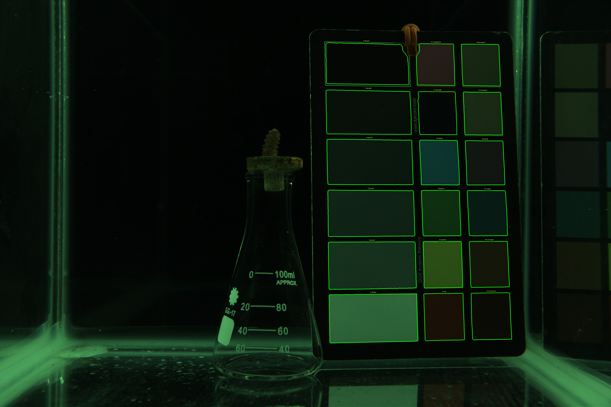
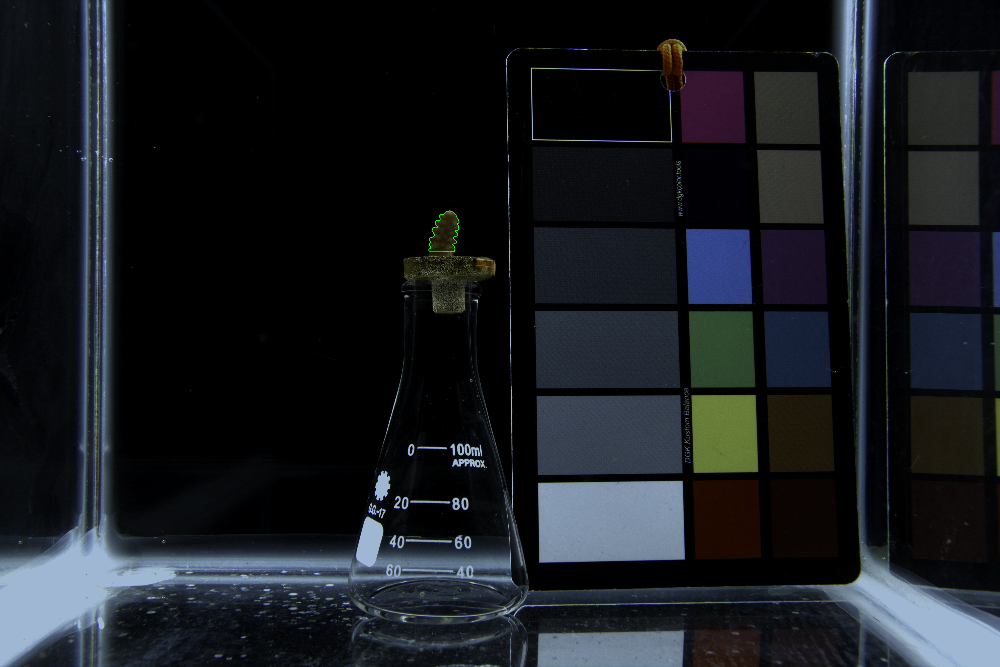

* Boaz Abramson - University of Haifa - Mass Lab & Color Lab
* **Supervisors:** Prof. Tali Mass & Prof. Derya Akkaynak
* **Date:** 12/11/26

This report summarizes the architectural, algorithmic, and quality-control upgrades implemented to transition the coral color-calibration and tissue-segmentation workflow from a monolithic script (`MASTER_V7.m` / `Master_V6_2_FixedVisual.m`) to a modular, Segment Anything Model (SAM)-driven pipeline (`MASTER_V13.m`).

---

### 1. Color Chart Calibration & Sampling Upgrades (Stage 1)

* **Full-Patch Surface Area Sampling via SAM:** Replaced fixed 11 × 11 pixel (121-pixel) center-point bounding boxes with automated Segment Anything Model (SAM) masks that sample the maximum interior surface area of all 18 color patches, dramatically improving signal-to-noise ratio across the chart.
* **Direct `DGKColorChart.mat` Indexing & Labeling:** Eliminated the manual `patch_mapping` permutation vector by aligning extraction order directly with the 1–18 index and exact color labels (`'white'`, `'gray1'`–`'gray4'`, `'black'`, `'red'`, `'yellow'`, `'green'`, `'blue'`, `'purple'`, `'magenta'`, `'maroon'`, `'orange'`, `'cyan'`, `'pink'`, `'brown1'`, `'brown2'`) defined in `DGKColorChart.mat`.
* **Streamlined 4-Corner Prompting:** Removed the unnecessary interactive zoom-pause steps and replaced generic corner labels (`Top-Left`, `Top-Right`, etc.) with explicit DGK patch numbers and names (`Patch 6: black`, `Patch 18: brown2`, `Patch 13: maroon`, `Patch 1: white`).
* **True Physical DGK Aspect-Ratio Geometry:** Corrected the projective transformation grid to account for the physical DGK Kustom Balance layout—modeling Column 1 (`white` through `black`) at 2× the width of Columns 2 and 3—and constrained SAM with tilted projected polygons so middle-column patches (`7: red` through `12: magenta`) are never clipped on angled charts.
* **Shadow-Boosted Feature Extraction for Dark Patches:** Applied a display-only gamma shadow boost (γ = 0.45) and local brightening (`imlocalbrighten`) solely for the SAM encoder and UI preview, enabling clean edge detection on low-reflectance patches (`11: purple` and `6: black`) against the black chart frame without altering the underlying linear 16-bit image data used for calibration.
* **Dynamic Corner Carryover with Per-Image SAM Re-Evaluation:** Replaced rigid pixel-mask carryover between images with corner-coordinate carryover (`prevCornerPoints`) that automatically re-runs SAM on each new image to adapt to slight chart movements.
* **Interactive Polygon Patch Refinement:** Replaced rigid rectangular adjustment boxes with an interactive polygon editor (`drawpolygon`) supporting vertex dragging, new polygon drawing, and targeted section erasure (e.g., removing lanyard overlap).
* **Persistent Mask Caching:** Individual chart mask sets (`Masks_<imgName>.mat`) are saved to disk so downstream adjustments to calibration math or white balance never require re-segmenting the chart.

 

*Figure 1: Automated visual quality-control export (`QC_Chart_A2_9D_MG_9022.jpg`) demonstrating 18-patch SAM surface area segmentation with high-contrast outlines and exterior patch labels.*

---

### 2. Coral Tissue Segmentation Upgrades (Stage 2)

* **Transition from Otsu Thresholding to Interactive SAM:** Replaced grayscale Otsu binarization (`graythresh`) and manual threshold locking with interactive SAM point prompting inside the cropped Master ROI.
* **Immediate Foreground Point Selection:** Removed automatic center-point assumptions at the start of each coral image; the UI immediately activates crosshairs for the operator to click foreground tissue points (`[f]`), background exclusion points (`[x]`), or clear all points (`[c]`) for a fresh selection, alongside freehand polygon add/erase (`[a]` / `[e]`) tools.

 

*Figure 2: Automated visual quality-control export (`QC_Coral_CAL_A2_9D_MG_9022.jpg`) demonstrating interactive SAM coral tissue segmentation.*

---

### 3. Quality Control, File Naming & Directory Management

* **Unaltered `.jpg` Sanity Check Overlays:** Automated the export of visual quality-control images for both the 18-patch color chart (`SanityCheck_Chart_Masks/QC_Chart_<imgName>.jpg`) and the isolated coral nub (`SanityCheck_Coral_Masks/QC_Coral_<imgName>.jpg`). High-contrast 2-pixel boundary outlines are burned directly into the unstretched image data to preserve true pixel appearance, with chart labels anchored above the top border (`CenterBottom`) completely outside the sampled patch area.
* **Standardized `CAL_` Prefix & Centralized Export Directory:** Shortened the calibrated image prefix from `Transformed_` to `CAL_` across all file filters and metadata parsers, and consolidated all pipeline outputs (`Color_Transformed_Images`, `Saved_Chart_Masks`, `SanityCheck_Chart_Masks`, `SanityCheck_Coral_Masks`, checkpoints, and final `.csv` tables) into the operator-defined `exportFolder`, leaving the raw `tiffFolder` untouched.

---

### 4. Software Architecture: Modular Single-Responsibility Functions

To ensure testability, maintainability, and clean separation of concerns, the monolithic script was refactored into **8 standalone MATLAB functions** orchestrated by `MASTER_V13.m`:

| File / Function | Single Responsibility |
| --- | --- |
| **`MASTER_V13.m`** | High-level two-stage pipeline orchestrator (directory setup and batch loops). |
| **`getMasks.m`** | Generates, interactively refines (via SAM + polygons), and saves/loads the 18 DGK chart patch masks (`.mat`). |
| **`visualizeMasks.m`** | Burns high-contrast mask outlines and exterior top-edge labels onto unaltered images and exports `.jpg` QC files. |
| **`getAvgRGB.m`** | Pure mathematical function computing the N × 3 mean RGB matrix across any cell array of N logical masks (N=18 chart or N=1 coral). |
| **`applyColorCalibration.m`** | Solves the overdetermined system via Moore-Penrose pseudoinverse (`pinv`), applies the 3 × 3 matrix `T`, and converts to ProPhoto RGB. |
| **`parseNubMetadata.m`** | Parses filenames (`CAL_`, `Transformed_`, or raw) into Colony/Nub ID, rotation letter, and dataset format. |
| **`manageCheckpoint.m`** | Manages Stage 2 `.mat` checkpoint loading, interactive resume/review menus, and Master ROI initialization. |
| **`segmentCoral.m`** | Encapsulates the 3-panel interactive SAM coral segmentation GUI and keyboard navigation controls. |
| **`exportNubStats.m`** | Aggregates per-rotation RGB means by `Nub_ID`, flags coefficients of variation >10%, and exports the timestamped `.csv`. |
